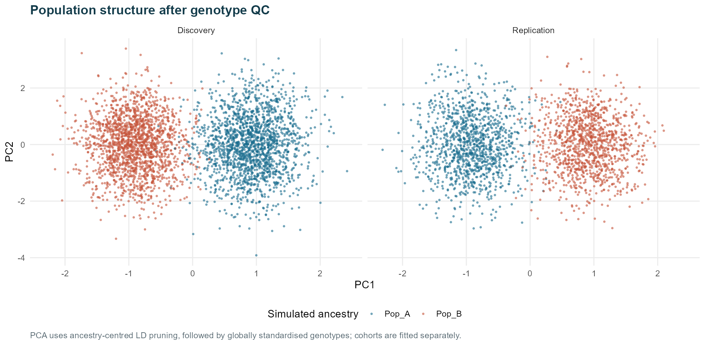
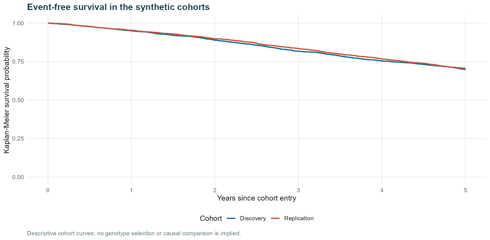
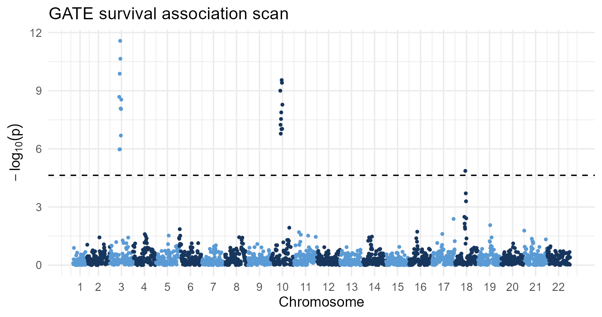
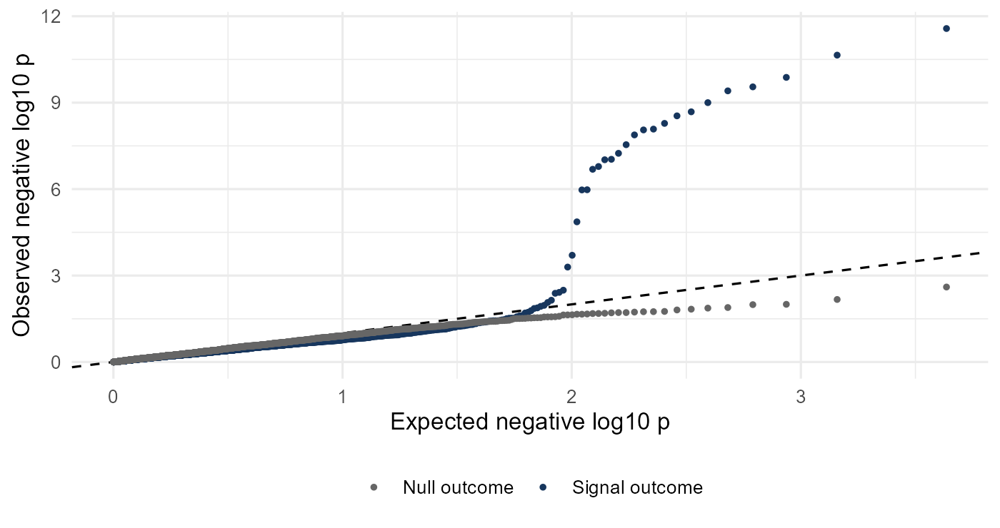
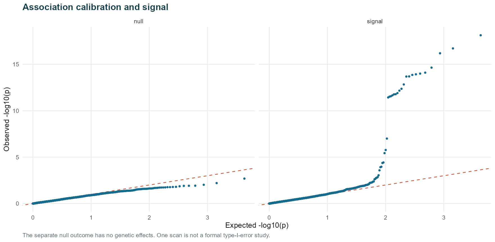
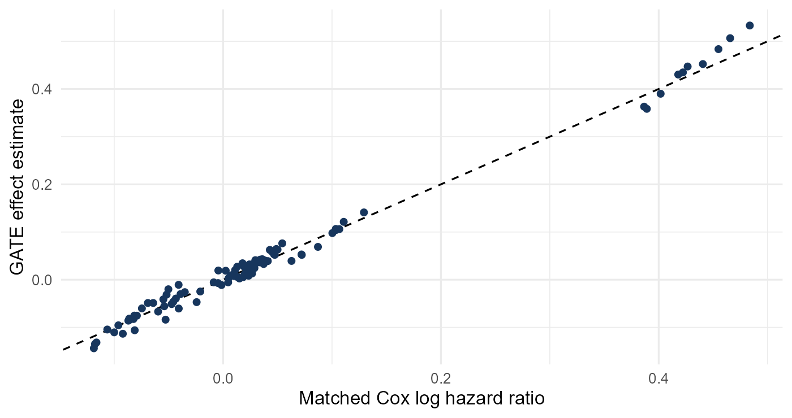
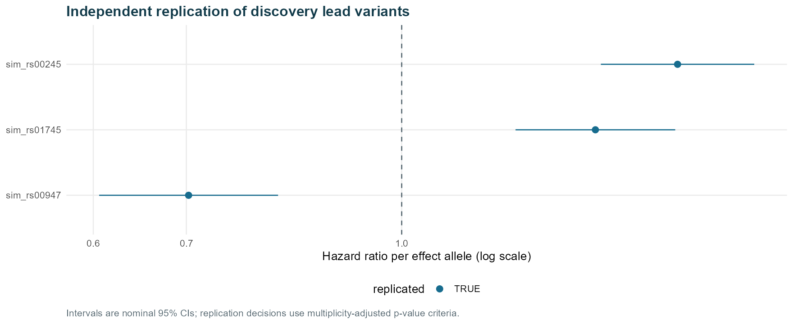
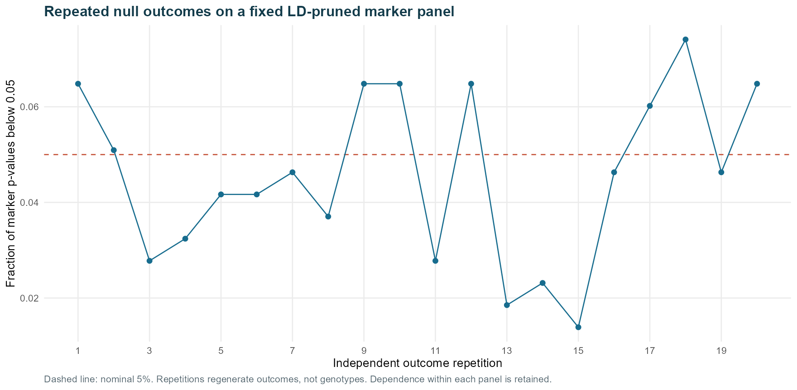

# Survival genome-wide association analysis with GATE and Cox models

## Scope

A reproducible computational study of survival association analysis using synthetic genotypes and time-to-event outcomes. The repository implements sample and variant quality control, population-structure adjustment, chromosome-level association testing, discovery and replication analysis, model diagnostics and R-generated reporting. A conventional Cox proportional hazards workflow is complemented by a GATE 0.45 survival mixed-model analysis of the same discovery cohort.

The study evaluates workflow execution, recovery of simulated association signals and selected calibration properties under a defined data-generating model. All participants, population groups, sites and outcomes are synthetic. No AWI-Gen or other participant-level research data are used. The marker panel and sample size support a controlled computational assessment rather than a claim of biobank-scale performance.

[View main figures and results](#main-figures-and-results) · [Statistical methods](#statistical-methods) · [Reproduce the analysis](#reproducibility-and-execution)

## Study design

The simulation specification is recorded in [config.R](config.R). Discovery and replication cohorts share generating parameters but have independently generated participants, genotypes and outcomes. Replication outcomes are not used to select discovery signals.

| Component | Specification |
|---|---|
| Cohorts | 3,600 discovery and 2,400 replication participants before fault injection |
| Population structure | Six fictional sites and two fictional ancestry groups within sites |
| Marker panel | 2,200 autosomal markers across 22 chromosomes; 10 blocks per chromosome and 10 markers per block |
| Linkage disequilibrium | Independently generated haplotypes; markers copy a block anchor with probability 0.93 or are redrawn from the population frequency |
| Genetic effects | Three direct-effect variants on chromosomes 3, 10 and 18, with conditional hazard ratios of 1.50, 0.67 and 1.40 |
| Survival model | Weibull proportional hazards with site, ancestry group, age and sex effects; independent dropout and administrative censoring at five years |
| Null outcome | The same covariate structure without genetic effects |
| Technical perturbations | Sample and variant missingness, heterozygosity outliers, exact duplicate records, monomorphic or rare markers and Hardy–Weinberg departures |
| Random seed | 20261008, with cohort-specific generation defined in the simulation code |

The simulated effect sizes are deliberately large to permit signal recovery in this limited sample. Marker coordinates are illustrative and do not correspond to a human genome assembly. The simulator produces RDS genotype matrices, phenotype TSV files and ordinary gzip-compressed VCFs. The primary Cox analysis uses the RDS matrices; the GATE extension exports PLINK and indexed VCF inputs. The workflow begins with simulated genotypes and does not include sequencing-read processing, imputation or a reference panel.

## Analytical workflow

```text
Independent discovery and replication cohorts
                    |
          Sample and variant quality control
                    |
              LD pruning and PCA
                    |
       +------------+---------------------------+
       |                                        |
Stratified Cox scans                    GATE discovery analysis
(signal and null outcomes)              PLINK/VCF input validation
       |                                Survival null-model fitting
Multiple-testing summaries              Chromosome-level SPA tests
       |                                        |
LD clumping and lead replication        Output and convergence checks
       |                                        |
PH and site diagnostics                 Matched Cox comparison (chr 3)
       |
Known-truth evaluation and repeated-null calibration
       |                                        |
       +------------- R reporting --------------+
                     HTML and Word
```

The [Snakefile](Snakefile) orchestrates the Cox, replication, calibration and reporting stages. GATE is executed separately through the dedicated scripts described in [GATE_PILOT.md](GATE_PILOT.md).

## PLINK preprocessing

A tested PLINK 2 branch now prepares both small synthetic survival cohorts through VCF import, missingness assessment, sample exclusions, MAF/MAC filtering, ancestry-specific Hardy–Weinberg checks, LD pruning, PCA and BED/BIM/FAM export. The [detailed workflow](PLINK_PREPROCESSING.md) explains every command, threshold, output and survival-model handoff; a [plain-text copy](PLINK_WORKFLOW.txt) is also available.

```bash
# WSL/Linux, from the repository root; set PLINK2 to your installed executable.
export PLINK2=/home/vusi/miniforge3/bin/plink2
bash run_snakemake.sh plink_preprocessing --dry-run
bash run_snakemake.sh plink_preprocessing
```

| Stage | Specification and output |
|---|---|
| Import | `--vcf --double-id --make-pgen`; full sample IDs retained as FID/IID |
| Sample QC | Existing R audit supplies duplicate, heterozygosity and phenotype exclusions; PLINK applies `--mind 0.03` |
| Variant QC | `--geno 0.02 --maf 0.05 --mac 100` after sample exclusions |
| HWE | Exact tests within each ancestry; exclude variants with p < 1e-6 in either group |
| LD pruning | `--indep-pairwise 250kb 1 0.2`; pruned markers used for PCA only |
| PCA | `--pca 3`; finite PCs joined to survival metadata by sample ID |
| GATE-format export | `--make-bed`; every BED call decoded and checked |
| Validation | Sample/variant IDs matched to R QC; every dosage compared with the original VCF; ALT-frequency tolerance 1e-5 |

PLINK's pooled-genotype LD pruning differs from the original R ancestry-centred procedure. The existing published Cox/GATE results retain their original PCs. The new files in `results/plink/{cohort}/` are a separately validated preprocessing branch; adopting these PCs in association models requires an explicit rerun. The two-field survival outcome (follow-up time and event status) is preserved in `survival_covariates.tsv`; a case–control PLINK `--glm` run is not substituted for survival analysis.

### Recorded small-dataset test

Both cohorts completed through Snakemake on 22 October 2026 using PLINK v2.0.0-a.7.8 (19 September 2026), two threads and 2,048 MB requested PLINK memory. Sample and variant sets matched the existing R QC outputs, and all dosage, BED, PCA and covariate-join checks passed.

| Cohort | Input samples | QC samples | QC variants | PCA markers | Genotype cells verified |
|---|---:|---:|---:|---:|---:|
| Discovery | 3,604 | 3,588 | 2,160 | 216 | 7,750,080 |
| Replication | 2,404 | 2,388 | 2,160 | 216 | 5,158,080 |

Each input contained 2,200 markers; 10 variants per cohort failed the ancestry-specific HWE stage after the preceding variant filters. The maximum ALT-frequency discrepancy was below 0.000001, consistent with printed-frequency rounding. Validation summaries: [discovery](results/plink/discovery/validation.json) and [replication](results/plink/replication/validation.json).

## Statistical methods

### Quality control and population structure

Sample exclusions comprise genotype missingness above 3%, robust within-population heterozygosity outliers, exact copied records and invalid phenotype records. Variant exclusions comprise missingness above 2%, minor allele frequency below 5%, minor allele count below 100 and an exact Hardy–Weinberg p-value below 10^-6 in either simulated population.

Local LD pruning uses an r-squared threshold of 0.2 within 250 kb. Genotypes are centred within population for LD calculations to separate local correlation from between-population allele-frequency differences. Three principal components are calculated independently in each cohort from globally variance-standardised, pruned genotypes. Mean-filled genotypes are used for PCA and LD calculations; Cox association models use per-variant complete cases.

These thresholds define the present experiment. The duplicate check identifies exact copies and does not estimate general kinship. Sex concordance, array batch effects, imputation quality and real reference-allele harmonisation are outside the simulation.

### Cox association and replication

Each eligible marker is tested using the following model:

```r
coxph(Surv(time, event) ~ dosage_j + age10 + male +
        PC1 + PC2 + PC3 + strata(site, ancestry_group),
      ties = "efron")
```

Dosage counts copies of the ALT allele (`G`), and `age10` represents centred age per ten years. Site and ancestry group define baseline-hazard strata. Two-sided Wald tests are used for the common-variant panel. Each fit records its sample size, event count and fit status; warnings, singularity and nonfinite estimates are retained for assessment.

The primary significance threshold is 0.05 divided by all QC-passing variants, including variants whose model subsequently fails. The conventional 5 × 10^-8 threshold is reported separately, and Benjamini–Hochberg q-values provide supplementary exploratory summaries. Discovery leads are selected by p-value and clumped within 250 kb at ancestry-centred r-squared ≥ 0.2. Replication requires concordant effect direction and a two-sided p-value below 0.05 divided by the number of discovery leads; leads failing replication QC remain in that denominator.

Global and term-specific Schoenfeld-residual diagnostics assess proportional hazards for selected lead models. Site-specific estimates provide sensitivity analyses. These selected-model diagnostics are exploratory. LD clumping does not establish causal variants or fine-mapped independence.

### GATE survival mixed-model analysis

GATE 0.45 was built from source commit `962f1028120c73e24ec34f29e02eeae3bdc3bfb3`. The discovery analysis uses the exported QC genotype panel, observed follow-up time in years and event coding of 1 for events and 0 for censoring. Covariates include age, sex, three PCs and explicit site and ancestry-group indicators. The implementation uses a genotype-derived relationship matrix and `LOCO=FALSE` for both signal and null analyses.

GATE null-model convergence is checked before chromosome-level association testing. The PLINK BED export is decoded and compared with the original genotype matrix, including missingness. VCF analysis uses bgzip compression and a CSI index. Output checks assess variant and participant counts, identifiers, coordinates, allele orientation, allele frequencies, finite estimates, valid p-values, positive variance and saddlepoint-approximation convergence.

The original Cox scan and GATE analysis differ in their treatment of site and ancestry: stratified baseline hazards in the former and explicit covariate indicators in the latter. A separate chromosome 3 Cox comparator uses matched covariates and mean-imputed genotypes. Differences between the full scans therefore cannot be attributed solely to the association-testing method.

## Main figures and results

The figures and tables below report the completed synthetic-cohort analysis. Selected PNG figures and compact TSV results are included in this repository for direct viewing and download. Participant-level simulation files, full association outputs, fitted models, logs and complete reports remain excluded by [.gitignore](.gitignore). Figures were generated by [the Cox reporting script](scripts/report.R) and [the GATE reporting script](scripts/report_gate.R).

### Cohort retention

| Cohort | Records after fault injection | Retained participants | Retained variants | Signal-outcome events | Null-outcome events |
|---|---:|---:|---:|---:|---:|
| Discovery | 3,604 | 3,588 | 2,160 | 981 | 850 |
| Replication | 2,404 | 2,388 | 2,160 | 644 | 588 |

Source: [discovery_summary.tsv](results/qc/discovery_summary.tsv) and [replication_summary.tsv](results/qc/replication_summary.tsv). The additional four records in each initial cohort are injected duplicates.



**Figure 1. Population structure after QC.** Colours identify the two simulated ancestry groups. PCA was fitted separately in each cohort, so axis signs need not agree between panels.



**Figure 2. Event-free survival.** Kaplan–Meier curves describe the synthetic discovery and replication cohorts over five years; they are not genotype-specific or causal comparisons.

### Association scans

All four discovery scans tested 2,160 variants. The panel-wide Bonferroni threshold was 2.3148 × 10^-5.

| Method | Outcome | Panel Bonferroni hits | Hits at 5 × 10^-8 | Genomic inflation factor (λGC) |
|---|---|---:|---:|---:|
| Stratified Cox | Signal | 23 | 20 | 0.961 |
| Stratified Cox | Null | 0 | 0 | 0.848 |
| GATE | Signal | 21 | 13 | 0.713 |
| GATE | Null | 0 | 0 | 0.874 |

Sources: [signal_metrics.tsv](results/summary/signal_metrics.tsv), [null_metrics.tsv](results/summary/null_metrics.tsv) and [summary.tsv](results/gate/summary.tsv). Both Cox scans completed without failed fits. Both GATE null models converged, and each GATE scan passed 13 output checks. All required SPA tests converged: 56 for the signal outcome and 61 for the null outcome.



**Figure 3. GATE discovery association scan.** Peaks occur on chromosomes 3, 10 and 18. The dashed line marks the panel Bonferroni threshold (0.05/2,160); significance counts include correlated markers and should not be interpreted as independent loci.



**Figure 4. GATE p-value distributions.** Signal and null outcomes are compared with the uniform expectation. The observed deflation and the small marker panel limit calibration conclusions.



**Figure 5. Stratified Cox p-value distributions.** The signal outcome shows an upper-tail departure associated with the simulated effects; the separate null outcome shows deflation. A single null scan does not establish type-I-error control.



**Figure 6. Matched chromosome 3 comparison.** GATE effect estimates are compared with Cox log-hazard ratios using matched covariates and mean-imputed genotypes. The dashed line denotes equality. Agreement of estimates does not establish equivalent uncertainty or calibrated inference. [Download comparison results](results/gate/chr3_comparison.tsv).

### Independent Cox lead replication

The Cox discovery scan yielded three clumped leads. All three met the independent replication criterion of concordant direction and p < 0.01667.

| Lead variant | Chromosome | Discovery HR | Replication HR (95% CI) | Replication p-value |
|---|---:|---:|---|---:|
| sim_rs00245 | 3 | 1.612 | 1.579 (1.391–1.793) | 1.78 × 10^-12 |
| sim_rs00947 | 10 | 0.628 | 0.703 (0.606–0.815) | 3.04 × 10^-6 |
| sim_rs01745 | 18 | 1.341 | 1.378 (1.208–1.573) | 1.98 × 10^-6 |

Source: [lead_results.tsv](results/replication/lead_results.tsv). These are Cox lead-replication results; an independent GATE replication analysis is not part of the recorded extension.



**Figure 7. Independent Cox replication.** Points show replication hazard ratios per effect allele, with nominal 95% confidence intervals. The reference line is HR = 1. Replication decisions additionally require concordant direction and p < 0.01667. Both cohorts were generated under the same simulation model.

### Computational validation and null calibration

All 33 checks in [checks.tsv](results/validation/checks.tsv) passed. These cover HWE examples, allele-flip invariance, direct Cox-fit agreement, identifier alignment, injected-fault exclusions, scan completeness, multiple-testing arithmetic and separation of simulation truth from discovery analysis.

A supplementary Cox calibration experiment generated 20 independent null outcomes on the fixed discovery genotypes and tested 216 LD-pruned markers per repetition. The mean nominal rejection fraction was 0.0456, with Monte Carlo standard error 0.0040 and a t-based 95% interval of 0.0372–0.0540. The observed family-wise rejection fraction for this smaller panel was 0.05, with an exact binomial 95% interval of 0.0013–0.2487. No model fits failed. Source: [null_calibration_summary.tsv](results/validation/null_calibration_summary.tsv).

| Cox calibration measure | Recorded result |
|---|---:|
| Independent null-outcome repetitions | 20 |
| LD-pruned markers per repetition | 216 |
| Mean fraction of p-values below 0.05 | 0.0456 |
| Monte Carlo standard error | 0.0040 |
| 95% interval for mean nominal fraction | 0.0372–0.0540 |
| Mean genomic inflation factor | 1.009 |
| Family-wise rejection fraction on the pruned panel | 0.050 |
| Exact 95% interval for family-wise rejection fraction | 0.0013–0.2487 |
| Failed model fits | 0 |



**Figure 8. Repeated-null Cox calibration.** Each point represents a newly generated null outcome tested on the same 216-marker genotype panel. The dashed line marks the nominal 5% level; connecting lines follow repetition order and do not represent time. [Download per-repetition results](results/validation/null_repetitions.tsv).

The repeated-null experiment is conditional on the fixed genotype sample and uses a smaller panel than the full scan. It does not establish full-GWAS family-wise error or power. GATE's single null scan and the observed deflation require further calibration assessment; successful convergence and output checks alone do not establish calibrated inference.

## Reproducibility and execution

| Resource | Repository location |
|---|---|
| Simulation and analysis parameters | [config.R](config.R) |
| Workflow definition | [Snakefile](Snakefile) |
| Statistical and reporting code | [scripts](scripts) |
| Windows launcher | [run_pipeline.ps1](run_pipeline.ps1) |
| WSL launcher | [run_snakemake.sh](run_snakemake.sh) |
| Recorded Python package versions | [environment-lock.txt](environment-lock.txt) |
| GATE installation, compatibility changes and execution | [GATE_PILOT.md](GATE_PILOT.md) |
| GATE build configuration | [config/gate.Makevars](config/gate.Makevars) |

The recorded workstation uses Ubuntu-24.04 under WSL for Snakemake and Windows R 4.5.1 for the primary statistical workflow. The launcher requests two concurrent jobs and a 4 GB scheduling budget; these are scheduler declarations, not operating-system memory limits. R entry points use `--vanilla` to exclude personal startup profiles. R and reporting-package versions are recorded in `logs/environment.tsv` and `report/tables/package_versions.tsv`.

On the configured workstation:

```powershell
Set-Location D:\survival_gwas_simulation
.\run_pipeline.ps1 -DryRun
.\run_pipeline.ps1
```

Equivalent execution from WSL:

```bash
cd /mnt/d/survival_gwas_simulation
bash run_snakemake.sh --dry-run
bash run_snakemake.sh
```

Sequential execution of the primary R stages is available through `scripts/run_all.R`. Snakemake updates stages whose dependencies have changed; the sequential runner executes every stage. Output filenames are stable, so configuration changes and reruns can replace existing results. Preserve a separate output archive when comparing configurations.

A fresh installation requires the R dependencies checked in [scripts/preflight.R](scripts/preflight.R), the officer package for Word reporting, an isolated Snakemake environment at `.venv/`, and an appropriate R executable. On Linux, set `R_SCRIPT=Rscript`; the wrapper's default Windows R path is specific to the recorded workstation. The Python version listing does not provision the R or GATE environments.

The GATE runtime uses a separate Linux environment within `tools/gate-runtime.ext4`, mounted at `/mnt/gate-runtime` on the Toshiba drive. Its installation and build-compatibility modifications are documented in [GATE_PILOT.md](GATE_PILOT.md). The chromosome 3 pilot fits the signal null model needed by the full-scan wrapper. After preparing inputs and completing installation, the pilot and full-analysis wrappers are executed in that order, followed by `scripts/summarise_gate.R` and `scripts/report_gate.R`. The GATE runtime, source archive and generated inputs are not distributed in this repository.

## Reporting and output record

Reports are generated in R using ggplot2, gtsummary, flextable and officer. Word documents contain editable text and tables with embedded figures. The primary Word stage is included in both Snakemake and `scripts/run_all.R`; the GATE supplement is rendered separately.

| Generated location | Contents |
|---|---|
| `report/index.html` | Main Cox, replication and calibration report |
| `report/Survival_GWAS_Results.docx` | Primary Word results report |
| `report/GATE_Survival_GWAS_Results.docx` | GATE results supplement |
| `report/tables/` and `report/plots/` | Report tables, R objects, figures and package versions |
| `results/qc/` and `results/pca/` | QC decisions, principal components and pruned marker sets |
| `results/summary/` | Full Cox association results and scan summaries |
| `results/replication/` | Leads, clumps, replication and model diagnostics |
| `results/gate/` | GATE models, association results, checks and comparison summaries |
| `results/validation/` | Computational checks, truth recovery, calibration and source checksums |
| `logs/` | Execution logs and environment records |
| `data/truth/` | Simulation truth used only for evaluation after discovery |

To regenerate the primary Word report after its reporting inputs exist:

```powershell
& 'C:/Program Files/R/R-4.5.1/bin/Rscript.exe' --vanilla scripts/report_word.R
```

## Interpretation

The recorded analyses demonstrate execution of survival association workflows and recovery of selected simulated signals. Replication represents an independent sample from the same generating model, rather than transferability across real populations. The simulation contains unrelated individuals and cannot establish GATE's advantages for familial relatedness or its computational performance at biobank scale.

Single-marker hazard ratios are marginal estimates in a simulation with multiple causal effects and can differ from the conditional generating coefficients. LD can produce significant tag variants without direct effects. Omitted causal predictors may also affect proportional-hazards diagnostics. The signal scan is therefore not a clean calibration experiment.

The observed null-scan deflation, limited Monte Carlo repetitions, simplified population structure and sparse marker panel constrain inferential conclusions. Application to real cohorts requires validated relatedness and population-structure handling, phenotype and genotype quality assessment, an appropriate analysis environment and independent evaluation of calibration and replication. GATE is a survival mixed-model association method, not a Bayesian posterior sampler.

## Method references

- [GATE source and implementation](https://github.com/weizhou0/GATE)
- [GATE survival GWAS method](https://www.nature.com/articles/s41467-022-32885-x)
- [survival::coxph documentation](https://stat.ethz.ch/R-manual/R-devel/library/survival/html/coxph.html)
- [PLINK quality-control guidance](https://www.cog-genomics.org/plink/2.0/tutorials/qc1)
- [PLINK principal components analysis](https://www.cog-genomics.org/plink/2.0/strat)
- [Snakemake documentation](https://snakemake.readthedocs.io/)
- [gtsummary conversion to flextable](https://www.danieldsjoberg.com/gtsummary/reference/as_flex_table.html)
